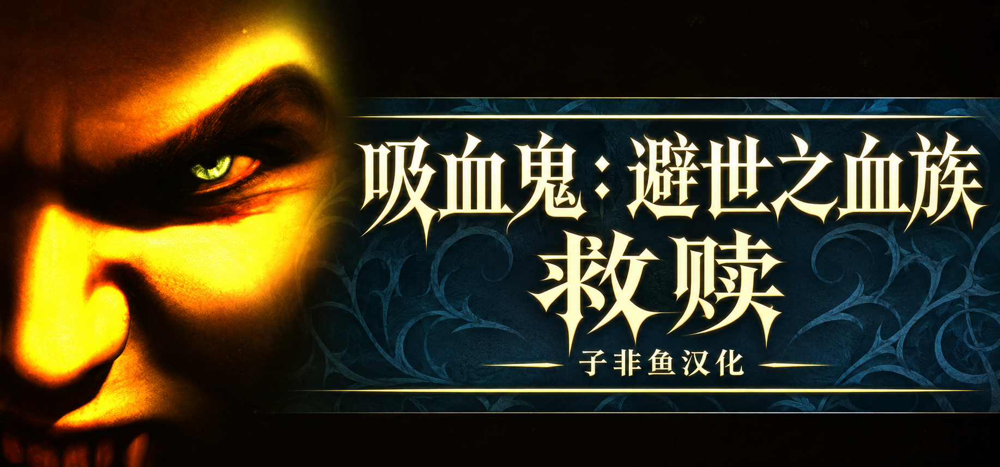

# [子非鱼Ai汉化]《吸血鬼：避世之血族－救赎》/《Vampire: The Masquerade – Redemption》

Steam商店: https://store.steampowered.com/app/559680/

下载与反馈

下载地址:https://github.com/zfyu222/vampire-the-masquerade-redemption-hanhua/releases/

或者网盘链接: Vampire-The Masquerade–Redemption  https://pan.baidu.com/s/5jX0pJapT1o7V1xWRs9fHxA

请订阅github地址或者网盘地址，以便在补丁更新时获得通知

游戏介绍

这是一款哥特风队伍角色扮演游戏。你将带领克里斯托夫与同伴，从中世纪的布拉格和维也纳追踪到现代的伦敦与纽约，在探索、队伍战斗和血族异能的运用中推进剧情。

安装汉化

将补丁解压到 Vampire.exe 所在目录，双击「安装汉化.cmd」，按提示选择从 Nexus 下载的 Crimson Edition 原始 ZIP，安装后从 Steam 启动。

补丁升级

覆盖解压新版补丁后，双击「安装汉化.cmd」。

卸载汉化

退出游戏后，双击「卸载汉化.cmd」。

适用版本

Steam Build 1472805 + VTMR Crimson Edition 1.0 标准 16:9 版

Windows PC（Steam）

汉化内容

简体中文界面、剧情对白、字幕、任务与文档，以及部分含文字贴图。适配 Crimson Edition 新增的界面提示和宽屏布局。

Crimson 原包出处：Cristi 制作的 VTMR Crimson Edition。

https://www.nexusmods.com/vampireredemption/mods/12

说明

本补丁使用 AI 辅助翻译，请适当降低预期。

发布日期：2026-11-25

更新日志

v1.0：首次发布。

